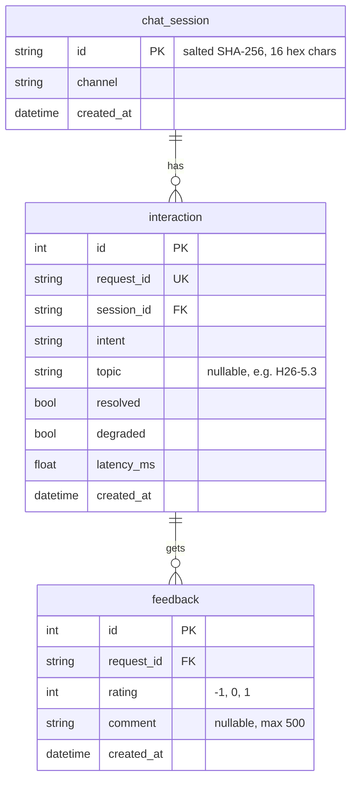

# Lab 5 — Data model worksheet

## 1. Critique the bad schema (sql/bad_schema.sql)
| # | Problem | Why it hurts | Fix |
|---|---|---|---|
| 1 | `id INTEGER` has no `PRIMARY KEY` | Two rows can share an id or have no id, so we cannot point to exactly one chat, and no other table can use it as a foreign key. | `interaction.id INTEGER PRIMARY KEY`, plus `request_id ... UNIQUE` as the id the API shows to the UI. |
| 2 | `student_name`, `student_phone` stored on every row | Personal data that no feature needs (Personal Data Protection Law); a leak exposes every student, and the same name/phone is repeated in many rows. | Do not store them. A conversation is identified only by `chat_session.id` = SHA-256 of the session id with a secret salt. |
| 3 | `message` and `answer` kept forever | The raw question can contain names, student ids or private situations. Keeping it forever multiplies the risk for no benefit. | Store only metadata: `intent`, `topic`, `resolved`, `degraded`, `latency_ms`. The answer can be rebuilt from the handbook. |
| 4 | `intent TEXT` is free text (`'fee'`, `'Fee'`, `'FEE'`, `'tuition'`) | `GROUP BY intent` splits one intent into several groups, so the counts are wrong. | The router writes a fixed set of lower-case values (`fee`, `rule`, `office`, `greeting`, `unknown`); the column is indexed for grouping. |
| 5 | `time TEXT` like `'5/10/2026 9:03 PM'` | Text sorts letter by letter, so `ORDER BY time` is wrong, and date functions cannot read it (is it 5 October or 10 May?). | `created_at TIMESTAMP` in UTC, filled by the program, never typed by hand. |
| 6 | `feedback TEXT` as `'1,-1,1'` | One cell holds many values: we cannot `COUNT`/`AVG` ratings, cannot add a comment or time per rating, and nothing blocks a rating of 7. | A separate `feedback` table: one row per rating, `request_id` foreign key to `interaction`, `rating` checked to -1/0/1. |
| 7 | `latency TEXT` like `'120ms'` | `AVG('120ms')` is meaningless and `'90ms' > '120ms'` as text. | `latency_ms REAL`: a number, with the unit in the column name. |

## 2. Store or not? (privacy-aware storage)
| Data | Store? | Form (raw / hashed / aggregated / none) | Retention | Reason |
|---|---|---|---|---|
| raw user message | no | none | — | May contain personal details; no feature needs the full text. |
| session id | yes | hashed (SHA-256 + secret salt from `.env`) | as long as the interaction rows | Lets us count questions per conversation without knowing who it is. |
| intent, latency, topic | yes | raw (metadata only) | one semester, then aggregated | Tells us which intents are slow or fail, and which handbook topics need work. |
| feedback rating | yes | raw (-1 / 0 / 1) | one semester, then aggregated | The whole point of feedback: measure which answers help. |
| feedback comment | yes, optional | raw, max 500 chars | short (e.g. 90 days) | Explains *why* an answer was bad; free text may contain personal data, so keep it briefly. |
| student name / phone | no | none | — | No feature needs it. |

## 3. Product questions → fields
| Product question | Fields needed | Table(s) | Query sketch |
|---|---|---|---|
| Most failed intent? | `intent`, `resolved` | `interaction` | `SELECT intent, COUNT(*) FROM interaction WHERE resolved = 0 GROUP BY intent ORDER BY 2 DESC;` |
| Average response time by intent? | `intent`, `latency_ms` | `interaction` | `SELECT intent, ROUND(AVG(latency_ms), 1) FROM interaction GROUP BY intent;` |
| Top unresolved topics? | `topic`, `request_id`, `rating` | `interaction` JOIN `feedback` | `SELECT i.topic, COUNT(*) FROM interaction i JOIN feedback f ON f.request_id = i.request_id WHERE f.rating = -1 GROUP BY i.topic ORDER BY 2 DESC;` |

## 4. ER diagram

